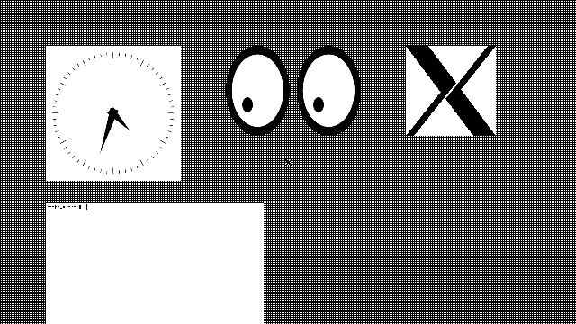

# xenos-linux-gpu

Hardware-accelerated OpenGL ES 2.0 and an accelerated X server on the Xbox 360 GPU (ATI Xenos), under Linux.

This repo holds everything from a two-day bring-up on a softmodded Xbox 360 (Trinity slim, Peer Pressure softmod, Xell): a kernel module that drives the Xenos command processor and implements enough of the msm DRM interface for Mesa, a Xenos variant of Mesa's freedreno a2xx driver, a big-endian patch for Xorg's glamor, the Khronos conformance harness we used to find bugs, and the tools that let a machine with no GPU reset debug its own hangs without a human pressing buttons.



*The live scanout buffer, read from memory and detiled on the host: Xorg with glamor, all rendering on the Xenos GPU, scanned out directly from the GPU's tiled render target. xclock, xeyes, xlogo and xterm, stipple root window, cursor.*

## Status (26 October 2026)

| | |
|---|---|
| Kernel | Linux 6.18.58 + Free60 xenon patch, netbooted by Xell, Debian unstable ppc64 on NFS |
| GPU driver | `xegpu.ko`: CP microcode and ring, fences on interrupts, boot-time contiguous pool, KMS display, msm UAPI subset with a command checker |
| GL | Mesa freedreno a2xx with a Xenos variant (gpu_id 290), GLES 2.0 only |
| Conformance | dEQP-GLES2 must-pass list (17,165 cases). Last complete sample: 829/859 pass; partial full run before the last two fixes: 14,436 of 14,642 executed cases pass (98.6%). A full run with all fixes is in `conformance/results/` once it finishes |
| X | Xorg 21.1 modesetting + glamor (GLES2), depth 24/32 accelerated, no hangs with xclock/xeyes/xlogo/xterm |
| Not done | Performance work (glamor redraws the whole framebuffer per batch), ETC1, cube-map mipmap filtering under dEQP, Vulkan (never) |

Nothing here writes to the console's NAND. The only change to the softmod is one byte in a file on the hard disk (see [docs/setup.md](docs/setup.md)).

## What was new

Most of the work was finding out where Xenos differs from the Adreno 200 that freedreno targets. They share an ISA and most of a register map, which made freedreno the right starting point and also made every difference silent: the GPU just stops. [docs/hardware-rules.md](docs/hardware-rules.md) lists each rule with the evidence. The ones that cost the most time:

- Pixel shaders get 16 GPRs after libxenon's `Xe_Init`. Any shader using a 17th register wedges the GPU. The kernel now splits the pool 64/64 through the ring the way `Xe_Init` does; a plain MMIO write to `SQ_GPR_MANAGEMENT` does nothing.
- GL's first submit wedged the GPU unless libxenon's init stream had run since the last CP init. The kernel now replays it before the first msm submit.
- ALU constants must be written as whole 16-constant blocks, fetch constants as whole 6-dword groups.
- The vertex shader must export every parameter slot it allocates, position first.
- Render targets smaller than 8x8 pixels wedge the GPU.
- `COHER_STATUS_HOST` bit 25 invalidates the vertex cache; bit 24 (what libxenon uses) only covers textures.
- Vertex fetch stride and offset are in dwords; the index DMA size is in 16-bit words; there are no 8-bit indices; primitive type 7 is not a line loop.
- `EVENT_WRITE_SHD` with `CACHE_FLUSH_TS` wedges the memory hub. Fences are `WAIT_UNTIL` idle + `MEM_WRITE`.
- Indirect buffers nest two deep at most.
- The Xenon CPU's VMX128 unit lacks the AltiVec integer multiply family, and the core lacks `ldbrx`/`stdbrx`, which `-mcpu=cell` emits. Build user space with `-mcpu=970 -mtune=cell -mno-altivec`.

## How it was debugged

The Xenos has no software reset. A wedged GPU stays wedged until the console loses power, and a bad memory write takes the whole console with it. We built an IR blaster (Arduino + IR LED) and patched one byte of the softmod so that a Windows Media Center remote's power code boots straight into Xell and Linux. A host script can now power-cycle the console in about 80 seconds, so a test harness can run thousands of GL tests, survive hangs, and attribute each hang to a test. [docs/methodology.md](docs/methodology.md) covers that, the replay tools, the Xenia-based linters and the footguns we hit on the way ([docs/footguns.md](docs/footguns.md)).

## Layout

```
kernel/xegpu/        xegpu.ko: CP, ring, fences, pool, KMS display (xenos_drm.c), msm UAPI (msm_compat.c)
kernel/include/      xegpu_uapi.h
kernel/xenon_idle/   low-priority idle loop for the Xenon SMT threads (1.85x single-thread speed)
kernel/patches/      Free60 kernel fixes: sis190 TX wake race, AltiVec for Xenon
userspace/           libxenon's xe.c/edram.c ported to Linux user space, xeinit (EDRAM training), tests, replay tool
mesa/patches/        git format-patch series on Mesa (base ab1502f), cross file
xorg/                glamor big-endian GLES patch (xorg-server 21.1.25)
gltest/              small GL probes, each aimed at one hypothesis
conformance/         dEQP-GLES2 harness with hang attribution and IR power cycling; dEQP big-endian patch
tools/               rd dump replay/bisect (rdstep), Xenia-table linters (xenoslint, xenosfields), decoders
irblaster/           Arduino sketch and host scripts for hands-off power cycling
softmod/             FATX in-place editor, SMC power-on reason reader
scripts/             bring-up scripts run on the console
docs/                setup, hardware rules, methodology, footguns, conformance, glamor, timeline
```

## Docs

- [docs/setup.md](docs/setup.md): netboot, NFS root, softmod patch, building everything
- [docs/hardware-rules.md](docs/hardware-rules.md): Xenos vs Adreno 200, with evidence
- [docs/methodology.md](docs/methodology.md): how to debug a GPU that can't be reset
- [docs/footguns.md](docs/footguns.md): things that cost us hours
- [docs/conformance.md](docs/conformance.md): dEQP pipeline and results
- [docs/glamor.md](docs/glamor.md): getting X accelerated
- [docs/timeline.md](docs/timeline.md): what happened when
- [docs/isa-a2xx-vs-xenos.md](docs/isa-a2xx-vs-xenos.md), [docs/path-c-plan.md](docs/path-c-plan.md): early design notes

## Credits

Built on Free60 (kernel patch, libxenon, Xell), the Xenia emulator's register and ISA documentation (src/xenia/gpu), Mesa's freedreno a2xx driver, Khronos VK-GL-CTS, and Peer Pressure. The work was done by an AI coding agent (Claude) driving a real console, with a human doing the soldering-iron-free hardware bits and the steering.

## License

See [LICENSE.md](LICENSE.md). Kernel code and the libxenon port are GPL-2.0, Mesa patches are MIT like Mesa, the dEQP patch is Apache-2.0 like VK-GL-CTS, docs are CC BY 4.0.
